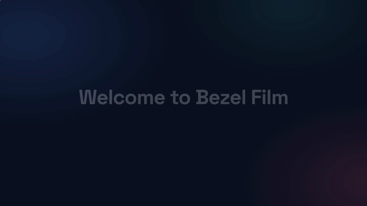

[](https://shazmoghaddam.github.io/)

# Bezel Film

[](https://github.com/ShazMoghaddam/bezel-film/actions/workflows/check.yml)
[](https://www.npmjs.com/package/bezel-film)
[](https://nodejs.org)
[](LICENSE)

**Turn an idea into a short narrated film. Just describe it.**

Bezel Film makes polished short films with a voiceover, captions, charts and music written for each film. Tell your coding agent what you want in plain words, and it does the rest. Everything runs on your own computer, with no accounts and no API keys.

<a href="docs/welcome.mp4"></a>

[▶ Watch the welcome film with sound](docs/welcome.mp4)

## Make your first film

You need [Node.js](https://nodejs.org) 22 or later, and ideally a coding agent such as Claude Code, Cursor or Codex.

**1. Set up a folder.** In an empty folder, run:

```bash
npx bezel-film init
```

It asks which coding agent you use, installs Bezel Film, downloads the voice and a browser once (about 200 MB), and makes a welcome film so you can see it work.

**2. Describe your film.** Open your coding agent in that folder and say what you want:

> Make a 45-second film about our 2026 sales, with upbeat music and a male voice.

It asks a few quick questions, writes the film, checks it and renders it.

**3. Watch it.** Your video is saved as `films/<name>/film.mp4`, ready to share.

No coding agent? Copy `films/welcome`, change the words and numbers in its `film.json`, then run:

```bash
npx bezel-film render films/<your-film>/film.json
```

## What you get

- **Films from your ideas, projects and data.** Titles, big numbers, charts, lists, code and quotes, each scene timed to its voiceover.
- **A natural voice.** Female or male, made on your computer. Hear the options with `npx bezel-film voices`.
- **Music written for every film.** Six moods, played on recorded piano, strings, harp and timpani, dipping whenever the voice speaks. Or bring your own track.
- **Made for every platform.** TikTok, Reels, Shorts, LinkedIn, X, WhatsApp and YouTube, each in the right shape with text kept clear of the app's buttons. Write one film and get every version, plus a cover image for each.
- **Charts that move.** Drawn with [Bezel Charts](https://github.com/ShazMoghaddam/bezel-charts), in bold colours.
- **Works with your agent.** Claude Code, Codex, Gemini CLI, Cursor, GitHub Copilot, Windsurf, and any agent that reads `AGENTS.md`.
- **Private and offline.** After the one-time download, nothing leaves your computer.
- **Smooth and repeatable.** Every frame is drawn on a frozen clock, so films look the same on any computer, every time.

> **Early days:** there's one visual style so far. More styles are on the [roadmap](#roadmap).

## Reference

Everything below is for when you want to go further or edit films by hand.

### Commands

| Command | What it does |
| --- | --- |
| `npx bezel-film init` | Sets up a folder: installs Bezel Film, adds agent instructions, makes a welcome film |
| `npx bezel-film render <film.json>` | Renders a film to an MP4 and a cover image next to the film file (`-o` to choose another path) |
| `npx bezel-film formats` | Lists the platform presets |
| `npx bezel-film validate <film.json>` | Checks a film file and shows a summary |
| `npx bezel-film voices` | Records a short line in eight recommended voices |
| `npx bezel-film setup` | Does the one-time downloads (voice and browser) |
| `npx bezel-film schema` | Prints the film file's JSON Schema |

`render` also takes `--for tiktok,reels,x` (or `--for all`) to make a version for each platform, `--show-safe-zones` to shade the parts each app covers, and `--no-cover`.

`init` also takes `--yes` (no questions), `--agents claude,cursor` and `--no-sample`, so agents and scripts can run it too.

### The film file

A film is a few settings plus a list of scenes. Only `spec`, `title`, `style` and `scenes` are required.

```json
{
  "$schema": "../../node_modules/bezel-film/schema/film.schema.json",
  "spec": 1,
  "title": "Northside Coffee: a year in numbers",
  "style": "data-story",
  "format": { "preset": "linkedin-mobile" },
  "scenes": [
    {
      "type": "stat",
      "value": "48,210",
      "label": "cups served",
      "narration": "We served just over forty-eight thousand cups."
    },
    {
      "type": "chart",
      "chart": { "type": "bars", "values": [9800, 11200, 12400, 14810], "labels": ["Q1", "Q2", "Q3", "Q4"] },
      "narration": "Every quarter beat the last."
    }
  ]
}
```

Each scene lasts as long as its narration, so the voice and visuals always line up. See the full [example film](examples/northside-coffee/film.json).

#### Scene types

| Type | Use it for | Main fields |
| --- | --- | --- |
| `title` | Opening card | `title`, `subtitle` |
| `stat` | One big number | `value`, `label`, `context` |
| `chart` | Any [Bezel Charts](https://github.com/ShazMoghaddam/bezel-charts) chart | `chart.type`, `chart.values`, `chart.labels` |
| `points` | Up to six short points | `heading`, `points` |
| `code` | A short code snippet | `language`, `code`, `highlight` |
| `quote` | A quote or testimonial | `quote`, `attribution` |
| `outro` | Closing card and call to action | `title`, `url`, `cta` |
| `custom` | Your own canvas scene | `module`, `props` |

Every scene can also take `narration`, `duration`, `transition` and `id`.

#### Settings

| Setting | Options | Default |
| --- | --- | --- |
| `style` | `data-story` (`product-launch` and `whiteboard` are coming) | required |
| `format.preset` | a platform, see [Platforms](#platforms) | none |
| `format.aspect` | `16:9`, `9:16`, `4:5`, `1:1` | from the preset, or `16:9` |
| `format.resolution` | `720p`, `1080p`, `4k` | from the preset, or `1080p` |
| `format.fps` | `24`, `30`, `60` | `30` |
| `voice.engine` | `kokoro`, `none` (`piper` is planned) | `kokoro` |
| `voice.gender` | `female`, `male` | `female` |
| `voice.voice` | a specific [Kokoro voice](https://huggingface.co/hexgrad/Kokoro-82M/blob/main/VOICES.md), e.g. `af_heart`, `bf_emma`, `bm_george` | `af_heart` |
| `voice.speed` | `0.5` to `2` | `1` |
| `music.source` | `generated`, `file`, `none` | `generated` |
| `music.mood` | `calm`, `upbeat`, `dramatic`, `epic`, `ambient`, `reflective` | `calm` |
| `music.nature` | `rain`, `waves`, `stream`, `wind` (ambient only) | picked from the title |
| `music.volume` | `0` to `1` | `0.2` |
| `music.file` | path to your own track, relative to the film file | none |
| `captions` | `true`, `false` | `true` |

### Platforms

Set `format.preset` to where the film will be posted. It sets the shape and size, and keeps titles, numbers and captions clear of the app's own buttons, names and captions.

| Preset | Shape | Best for |
| --- | --- | --- |
| `tiktok` | 9:16 | TikTok |
| `reels` | 9:16 | Instagram Reels (and Facebook Reels) |
| `shorts` | 9:16 | YouTube Shorts |
| `instagram` | 4:5 | Instagram feed posts |
| `linkedin-mobile` | 4:5 | LinkedIn, for people on their phones |
| `linkedin-desktop` | 16:9 | LinkedIn, for people on laptops |
| `linkedin-square` | 1:1 | LinkedIn, a middle ground for both |
| `x` | 16:9 | X (free accounts take up to 2 min 20 s) |
| `whatsapp` | 9:16, 720p | WhatsApp chats and Status, kept under 16 MB |
| `youtube` | 16:9 | YouTube and websites |

To post the same film in several places, render every version in one go. The voice and music are made once and shared:

```bash
npx bezel-film render films/launch/film.json --for tiktok,linkedin-mobile,x
```

This saves `film-tiktok.mp4`, `film-linkedin-mobile.mp4` and `film-x.mp4`, each with a cover image. `validate` warns if a film is too long for its platform, for example over 3 minutes for Shorts.

The safe zones come from each platform's published ad guidance (TikTok, Meta and Google, checked November 2026), as none of them publishes figures for ordinary posts. Content is always centred, with even margins. On TikTok, the like and share buttons sit over the lower right corner, so the end of a long caption or the edge of a wide chart can pass under them. To check a film by eye, add `--show-safe-zones` and the covered areas are shaded.

### Music

Every film gets its own music, composed from its title: the same film always sounds the same, and two films never sound quite alike. The music dips whenever the voice speaks, rises in the gaps, and fades out with the picture.

| Mood | How it feels |
| --- | --- |
| `calm` | Flowing piano broken chords and a gentle melody over warm cellos, with soft violins above |
| `upbeat` | A driving groove: full drum kit, deep pulsing bass, dark piano chords and strings |
| `dramatic` | Opens on a timpani rumble; cellos and violins build, with timpani hits, a solo violin and cymbal swells |
| `epic` | Dramatic, with a rolling frame drum groove and a choir swelling in |
| `ambient` | Rain, sea waves, a stream or wind in the leaves, with a few slow, distant piano and harp notes |
| `reflective` | Expressive solo piano, a breath, then a lone whistle with slow vibrato, answered by the piano |

To use your own track, set `"music": { "source": "file", "file": "my-track.mp3" }`. It's trimmed to the film's length, or fades out early if it's shorter.

### Voices

Hear the recommended voices before you choose one:

```bash
npx bezel-film voices
```

It records a short line in eight voices (four female, four male, including two British) and saves them, plus one file with them all in a row.

### Advanced settings

These environment variables are optional:

| Variable | What it does |
| --- | --- |
| `BEZEL_FILM_FFMPEG` | Path to the ffmpeg to use |
| `BEZEL_FILM_CHROME` | Path to a Chrome or Chromium to draw with |
| `BEZEL_FILM_CACHE` | Where downloaded models are kept (default `~/.cache/bezel-film`) |
| `BEZEL_FILM_WORKERS` | How many browser pages draw frames at once (default: spare CPU cores, up to 4) |

### Coding agents

`init` asks which agents you use (ticking the ones it finds) and adds instructions for each. Files other tools also use, like `AGENTS.md`, only get a clearly marked Bezel Film section added; your own text is never touched. Run `init` again to update them.

| Agent | File |
| --- | --- |
| Claude Code | `.claude/skills/bezel-film/SKILL.md` |
| Codex, and any agent that reads `AGENTS.md` | `AGENTS.md` |
| Gemini CLI | `GEMINI.md` |
| Cursor | `.cursor/rules/bezel-film.mdc` |
| GitHub Copilot | `.github/copilot-instructions.md` |
| Windsurf | `.windsurf/rules/bezel-film.md` |

### Installing by hand

Prefer not to use `init`? Install it into any project and do the downloads up front:

```bash
npm install --save-dev bezel-film
npx bezel-film setup
```

You don't need ffmpeg: Bezel Film uses yours if you have it, and otherwise fetches a copy when you install.

On Linux, the voice engine also tries to download large GPU files it doesn't need. Skip them by putting `ONNXRUNTIME_NODE_INSTALL_CUDA=skip` in front of the command, for example `ONNXRUNTIME_NODE_INSTALL_CUDA=skip npx bezel-film init`. Macs and Windows don't need this.

## Roadmap

- **v0.1.0 (released):** the `data-story` style, voiceover, captions and music
- **v0.2.0 (released):** `init`, so anyone can start in one command, and an agent-first README
- **v0.3.0 (released):** made for social: presets for TikTok, Reels, Shorts, Instagram, LinkedIn, X, WhatsApp and YouTube, with safe zones, vertical layouts, every version from one film, and cover images
- **v0.4.0:** premium motion: spring easing, staggered entrances and sound effects that land with the movement
- **v0.5.0:** product stories: map, timeline and roadmap scenes, and a draft film from a repo or README
- **v0.6.0 onwards:** more looks, including product launch, whiteboard and sketch, cinematic, playful and minimal

## Contributing

Ideas, bug reports and pull requests are welcome. See [CONTRIBUTING.md](CONTRIBUTING.md). To report a security issue, see [SECURITY.md](SECURITY.md).

## Licence

Bezel Film is [MIT](LICENSE) licensed. It downloads and uses these, each under its own licence:

- [Kokoro](https://huggingface.co/hexgrad/Kokoro-82M) voice model and [kokoro-js](https://github.com/hexgrad/kokoro): Apache 2.0
- [Playwright](https://github.com/microsoft/playwright) and Chromium: Apache 2.0 and BSD
- [ffmpeg](https://ffmpeg.org), via [ffmpeg-static](https://github.com/eugeneware/ffmpeg-static): GPL 3.0. It runs as a separate program and isn't part of Bezel Film's code.
- Space Grotesk, Inter and JetBrains Mono fonts: SIL Open Font License
- Instrument recordings from the [VS Chamber Orchestra: Community Edition](https://github.com/sgossner/VSCO-2-CE) by Versilian Studios: CC0 (public domain). See [instruments/CREDITS.md](instruments/CREDITS.md).

---

Created by **Shaz Moghaddam** · London
[Website](https://shazmoghaddam.github.io/) · [LinkedIn](https://www.linkedin.com/in/shazmoghaddam/)
