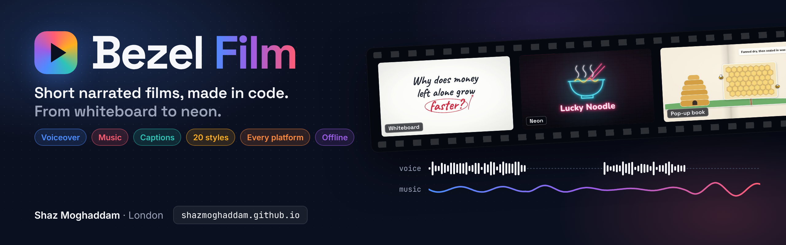

[](https://shazmoghaddam.github.io/)

# Bezel Film

[](https://github.com/ShazMoghaddam/bezel-film/actions/workflows/check.yml)
[](https://www.npmjs.com/package/bezel-film)
[](https://nodejs.org)
[](LICENSE)

**Turn an idea into a short narrated film. Just describe it.**

Bezel Film makes polished short films with a voiceover, captions, charts, music and sound effects. Tell your coding agent what you want in plain words, and it does the rest. Everything runs on your own computer, with no accounts and no API keys.

<a href="docs/welcome.mp4"></a>

[▶ Watch the welcome film with sound](docs/welcome.mp4)

## Make your first film

You need [Node.js](https://nodejs.org) 22 or later, and ideally a coding agent such as Claude Code, Cursor or Codex.

**1. Set up a folder.** In an empty folder, run:

```bash
npx bezel-film init
```

It asks which coding agent you use, installs Bezel Film, downloads the voice, a browser and the music once (about 230 MB), and makes a welcome film so you can see it work.

**2. Describe your film.** Open your coding agent in that folder and say what you want:

> Make a 45-second film about our 2026 sales, with upbeat music and a male voice.

It asks a few quick questions, writes the film, checks it and renders it.

**3. Watch it.** Your video is saved as `films/<name>/film.mp4`, ready to share.

No coding agent? Copy `films/welcome`, change the words and numbers in its `film.json`, then run:

```bash
npx bezel-film render films/<your-film>/film.json
```

### A film about your project

Point `draft` at a project folder, a README or a GitHub repository, and it writes a first film from what the project says about itself:

```bash
npx bezel-film draft ShazMoghaddam/bezel-charts -o films/charts/film.json
```

It reads the README, `package.json` or `pyproject.toml`, the changelog and (for a GitHub repository) the star count. Then it drafts a title, what the project does, how to start, how far it's come, what's next and a call to action, leaving out anything it found nothing for. It's a starting point, so ask your coding agent to make it tell a story, or edit it yourself, then render it. `draft` never overwrites a file.

## What you get

- **Films from your ideas, projects and data.** Titles, big numbers, charts, lists, code and quotes, each scene timed to its voiceover.
- **A natural voice.** Female or male, made on your computer. Hear the options with `npx bezel-film voices`.
- **Music for every mood.** Six moods, each with a few hand-picked pieces: public-domain recordings, or music composed for the film and played on recorded orchestral instruments. It dips whenever the voice speaks. Or bring your own track.
- **Made for every platform.** TikTok, Reels, Shorts, LinkedIn, X, WhatsApp and YouTube, each in the right shape with text kept clear of the app's buttons. Write one film and get every version, plus a cover image for each.
- **Fonts to suit the story.** Nine pairings, from a magazine serif to handwriting and a Swiss grotesque, shipped inside the package. See them with `npx bezel-film styles`.
- **Scenes your agent draws.** Beyond the ready-made scenes, your agent can write whole scenes in code: drawings that draw themselves, characters, anything. Bezel Film gives it a kit to build with, a director's guide, and checks that catch mistakes before you render.
- **Charts that move.** Drawn with [Bezel Charts](https://github.com/ShazMoghaddam/bezel-charts), in bold colours.
- **Works with your agent.** Claude Code, Codex, Gemini CLI, Cursor, GitHub Copilot, Windsurf, and any agent that reads `AGENTS.md`.
- **Private and offline.** After the one-time download, nothing leaves your computer.
- **Smooth and repeatable.** Every frame is drawn on a frozen clock, so films look the same on any computer, every time.

> **Styles:** seventeen so far, from whiteboard explainers and 1930s cartoons to watercolour journals and Swiss posters. More are on the [roadmap](#roadmap).

## Reference

Everything below is for when you want to go further or edit films by hand.

### Commands

| Command | What it does |
| --- | --- |
| `npx bezel-film init` | Sets up a folder: installs Bezel Film, adds agent instructions, makes a welcome film |
| `npx bezel-film draft <source>` | Drafts a film about a project from its folder, README or GitHub repository (`owner/repo`). Saves `film.json` (`-o` to choose another path, `--for` to set the platform) |
| `npx bezel-film preview <film.json>` | Saves stills of every scene and a contact sheet in seconds, and checks custom scenes. Look before you render (`--for` to see one platform) |
| `npx bezel-film render <film.json>` | Renders a film to an MP4 and a cover image next to the film file (`-o` to choose another path) |
| `npx bezel-film formats` | Lists the platform presets |
| `npx bezel-film styles` | Lists the styles and font pairings |
| `npx bezel-film guide [name]` | Prints a guide for agents: `director` (planning a film), `scenes` (writing custom scenes), or a style's own, e.g. `whiteboard` |
| `npx bezel-film icons <word>` | Finds line drawings for custom scenes, e.g. `coffee` |
| `npx bezel-film validate <film.json>` | Checks a film file and shows a summary |
| `npx bezel-film voices` | Records a short line in eight recommended voices |
| `npx bezel-film setup` | Does the one-time downloads (voice and browser) |
| `npx bezel-film schema` | Prints the film file's JSON Schema |

`render` also takes `--for tiktok,reels,x` (or `--for all`) to make a version for each platform, `--show-safe-zones` to shade the parts each app covers, `--quality high` for true motion blur in a final version, and `--no-cover`.

`init` also takes `--yes` (no questions), `--agents claude,cursor` and `--no-sample`, so agents and scripts can run it too.

### The film file

A film is a few settings plus a list of scenes. Only `spec`, `title`, `style` and `scenes` are required.

```json
{
  "$schema": "../../node_modules/bezel-film/schema/film.schema.json",
  "spec": 1,
  "title": "Northside Coffee: a year in numbers",
  "style": "data-story",
  "format": { "preset": "linkedin-mobile" },
  "scenes": [
    {
      "type": "stat",
      "value": "48,210",
      "label": "cups served",
      "narration": "We served just over forty-eight thousand cups."
    },
    {
      "type": "chart",
      "chart": { "type": "bars", "values": [9800, 11200, 12400, 14810], "labels": ["Q1", "Q2", "Q3", "Q4"] },
      "narration": "Every quarter beat the last."
    }
  ]
}
```

Each scene lasts as long as its narration, so the voice and visuals always line up. See the full [example film](examples/northside-coffee/film.json), a [product story](examples/northside-story/film.json) with a timeline, map and roadmap, and the [Bezel Charts film](examples/bezel-charts/film.json), a real project told in about a minute.

#### Scene types

| Type | Use it for | Main fields |
| --- | --- | --- |
| `title` | Opening card | `title`, `subtitle` |
| `stat` | One big number | `value`, `label`, `context` |
| `chart` | Any [Bezel Charts](https://github.com/ShazMoghaddam/bezel-charts) chart | `chart.type`, `chart.values`, `chart.labels` |
| `points` | Up to six short points | `heading`, `points` |
| `timeline` | Up to six dated events, oldest first | `heading`, `events` (`date`, `label`, `detail`) |
| `roadmap` | Up to six steps, each `done`, `in-progress` or `planned` | `heading`, `steps` (`label`, `status`, `when`) |
| `map` | Places, countries and routes on a world map | `heading`, `focus`, `pins`, `countries`, `arcs`, `legend` |
| `code` | A short code snippet | `language`, `code`, `highlight` |
| `quote` | A quote or testimonial | `quote`, `attribution` |
| `outro` | Closing card and call to action | `title`, `url`, `cta`, `links` (up to 4 stickers) |
| `custom` | Your own canvas scene | `module`, `props` |

Every scene can also take `narration`, `duration`, `transition`, `motion` and `id`.

#### Maps

Name places the way you'd say them: a city (`"Nairobi"`), a city with its country or state when the name is shared (`"Paris, France"`, `"Portland, Oregon"`), or a country (`"Brazil"`, `"the UK"`). The biggest place with that name wins, so `"Birmingham"` is the English one. For anywhere else, give coordinates: `{ "lat": 51.53, "lon": -0.12, "name": "Our office" }`. Every name is checked when the film is validated, with a suggestion if it looks like a typo.

```json
{
  "type": "map",
  "heading": "Where our beans come from",
  "pins": [{ "place": "Colombia" }, { "place": "Ethiopia" }, { "place": "London", "label": "Roasted here" }],
  "arcs": [{ "from": "Colombia", "to": "London" }, { "from": "Ethiopia", "to": "London" }],
  "narration": "Our beans come from farms in Colombia and Ethiopia, and we roast them here in London."
}
```

- `pins`: up to 8 places, each with an optional `label`.
- `countries`: up to 24 countries to colour in. Give each a `value` to shade them from low to high, with `legend`, `prefix` and `suffix` for the key.
- `arcs`: up to 6 curved lines, `from` one place `to` another.
- `focus`: where the camera ends up: `"world"`, a region (`"Europe"`, `"Africa"`, `"Middle East"`, `"Southeast Asia"` and more), a country or a city. Leave it out to fit everything shown.

Maps work at country and region scale, so places in the same city sit on top of each other. Outlines come from [Natural Earth](https://www.naturalearthdata.com), which shows borders as they are on the ground; see [maps/CREDITS.md](maps/CREDITS.md).

#### Settings

| Setting | Options | Default |
| --- | --- | --- |
| `style` | `data-story`, see [Styles and fonts](#styles-and-fonts) | required |
| `font` | a pairing, see [Styles and fonts](#styles-and-fonts) | the style's choice |
| `format.preset` | a platform, see [Platforms](#platforms) | none |
| `format.aspect` | `16:9`, `9:16`, `4:5`, `1:1` | from the preset, or `16:9` |
| `format.resolution` | `720p`, `1080p`, `4k` | from the preset, or `1080p` |
| `format.fps` | `24`, `30`, `60` | `30` |
| `voice.engine` | `kokoro`, `none` (`piper` is planned) | `kokoro` |
| `voice.gender` | `female`, `male` | `female` |
| `voice.voice` | a specific [Kokoro voice](https://huggingface.co/hexgrad/Kokoro-82M/blob/main/VOICES.md), e.g. `af_heart`, `bf_emma`, `bm_george` | `af_heart` |
| `voice.speed` | `0.5` to `2` | `1` |
| `music.source` | `generated`, `file`, `none` | `generated` |
| `music.mood` | `calm`, `upbeat`, `dramatic`, `epic`, `ambient`, `reflective` | `calm` |
| `music.track` | a piece from the [Music](#music) table, or `composed` | picked from the mood and title |
| `music.nature` | `rain`, `waves`, `stream`, `wind` (ambient only) | picked from the title |
| `music.volume` | `0` to `1` | `0.2` |
| `music.file` | path to your own track, relative to the film file | none |
| `sfx.volume` | `0` to `1`, where `0` turns them off. See [Sound effects](#sound-effects) | `0.5` |
| `captions` | `true`, `false` | `true` |
| `motion` | `calm`, `lively`, `punchy`, see [Motion](#motion) | the style's choice (`lively`) |

### Custom scenes

When the ready-made scenes can't show something, a `custom` scene can. Your agent writes its code in a small file next to the film, and the film file says where it goes:

```json
{ "type": "custom", "file": "scenes/steps.js", "props": { "steps": ["You order", "We make it", "At your door"] },
  "narration": "You order in the app. A barista makes it fresh. And a rider brings it round.",
  "sounds": [{ "at": 0.2, "sound": "tap" }] }
```

The scene draws everything in its part of the film, while Bezel Film adds the voice, captions, music, transitions and every platform's format around it. Custom and ready-made scenes mix freely, so a hand-drawn scene can lead into a real chart. See `examples/custom-scenes` for a working film.

- **A kit to build with.** Every scene gets the frame's safe area, the style's colours and fonts, when each sentence is spoken, springs and easing, and lines and words that draw themselves, with an optional marker pen following the tip. It also has 5,491 line drawings to draw with (`npx bezel-film icons coffee` finds them), hand-drawn shapes, posable stick figures, cartoon characters, isometric blocks, technical measurements, comic panels, speed lines, screentone, paper cut-outs and pop-ups, crayon scribbles, origami folds, soft glows, watercolour washes, layout grids, comic starbursts and speech bubbles, and riso ink layers.
- **Guides.** `npx bezel-film guide director` walks an agent through planning a film like a director: the hook, the script, the shots, the sound and a quality check. `npx bezel-film guide scenes` is the kit's reference.
- **Checks.** `preview` and `render` check every custom scene: it must draw the same picture every time it's asked for the same moment, keep its words inside the safe area, keep them readable, and draw quickly. Each problem names the scene and how to fix it, so your agent can fix it without you.
- **Safe and offline.** Scene code runs in the same sealed browser as everything else: every outside request is blocked, and it can only load files from the film's own folder. Your agent uses its usual connection to write the code; Bezel Film itself never goes online.

### Styles and fonts

A style is the film's look: its colours, backdrop, fonts and the way things move. Each one is a different kind of film, not just a new colour scheme:

| Style | What you get | Good for |
| --- | --- | --- |
| `data-story` | Clean, chart-led scenes with big numbers and bold colour | Data, results, product updates |
| `whiteboard` | A marker pen draws and writes each idea as it's spoken | Explainers, lessons, how things work |
| `stick-figures` | Stick people act the idea out on notebook paper | Habits, choices, stories about people |
| `isometric` | A small 3D-looking world where blocks rise and things move through it | Journeys, systems, how things get made |
| `blueprint` | Technical drawings plotted in white on blue paper | Products, hardware, specs |
| `data-on-paper` | A data journal: charts drawn in coloured pencil on graph paper | One striking number, science, surveys |
| `mid-century-cartoon` | A 1950s cartoon: flat colour, geometric characters, snappy pose-to-pose movement | Friendly how-tos and tips |
| `rubber-hose-cartoon` | A 1930s cartoon: bendy black-and-white characters bouncing on flickering film | Playful ads, food and drink |
| `manga` | A comic page: panels slam in, with speed lines, screentone and sound effects | Dramatic launches and reveals |
| `pop-up-book` | A storybook spread: card cut-outs spring up off the page, layer by layer | Explainers for families, nature, warm brand stories |
| `crayon-book` | A picture book in wax crayon on dark paper, coloured in as you watch | Gentle "why" questions, science, bedtime stories |
| `origami` | Folded paper that folds, crease by crease, into each idea | App and product launches, simple steps |
| `paper-lantern` | Cut paper layers lit from behind at night, drifting past each other | Travel, journeys, calm atmospheric stories |
| `watercolour` | A nature journal that paints itself: soft washes, ink lines and notes in the margins | Nature, science, travel, gentle explainers |
| `swiss-poster` | A strict grid, big neutral type and one signal red, snapping into place | Events, announcements, schedules, key numbers |
| `pop-art` | Comic dots, bold outlines, starbursts and speech bubbles that punch in | Loud product ads, food and drink, launches |
| `risograph` | A zine printed one ink at a time: bright inks overlapping, slightly off, with grain | Indie brands, events, creative projects |

Every style apart from Data story is made for [custom scenes](#custom-scenes): your agent draws each film from scratch in the style, so no two films look alike. Each has a guide for agents (`npx bezel-film guide whiteboard`) and an example film in `examples/`. Ready-made scenes take on their look too.

Each style has its own fonts, and `font` swaps them for another pairing. A pairing is a heading font and a body font chosen to suit each other, so they never clash:

| Pairing | Headings and body | Feel |
| --- | --- | --- |
| `grotesk` | Space Grotesk and Inter | Modern and confident. Tech, data and product stories |
| `editorial` | Fraunces and Source Serif 4 | A magazine serif. Considered, classic and calm |
| `condensed` | Oswald and Barlow | Tall and narrow, like a news headline. Fits long titles |
| `bold` | Archivo Black and Inter | Heavy, poster-like headings with a clean body |
| `technical` | IBM Plex Sans | Precise and engineered. Plans, systems and specs |
| `friendly` | Nunito | Soft and rounded. Warm explainers for everyone |
| `handwritten` | Caveat and Patrick Hand | Written by hand, like a whiteboard or a notebook |
| `mono` | Space Mono and JetBrains Mono | Typewriter and terminal. Best with short headings |
| `swiss` | Inter | Neutral and exact, like a Swiss poster. Events, posters and grids |

The fonts ship inside the package, so films look the same on every computer. They cover English and other languages written in the Latin alphabet, accents included (Zoë, Ştefan, Łódź). Text in other alphabets, like Persian, Japanese or Greek, falls back to a system font for now.

Chart labels use the system font for now, whatever the pairing.

### Motion

Everything moves on springs, so it settles into place with a little life rather than sliding to a stop. Set `motion` for the whole film, or on a single scene:

| Level | Feel |
| --- | --- |
| `calm` | Smooth and simple. The look from v0.3.0 and earlier |
| `lively` | Springy, with headings that appear word by word and numbers that pulse as they land. The default |
| `punchy` | Bigger and bouncier. Made for short social films |

Every frame is still exact: the same film always renders the same video.

Things in motion get a touch of motion blur in `lively` and `punchy`, as a film camera would catch them, and settle back to sharp the moment they stop. `calm` has none. The blur is drawn as each frame is made, so it adds almost nothing to the render time. For a final version, `--quality high` makes true motion blur instead: each frame is blended from five snapshots across the shutter. It's the most natural look, and takes about five times as long.

### Sound effects

Sounds land with the movement: a whoosh between scenes, a soft tap as a number or chart appears, a pop for chips and buttons, a swish for each point, and ticks as a number counts up, ending in a small chime. They're real recordings from CC0 sound packs, shipped inside the package, so there's nothing extra to download. They play more quietly while someone is speaking.

They're on by default and kept subtle. Set `"sfx": { "volume": 0 }` to turn them off, or raise the volume up to `1`.

### Platforms

Set `format.preset` to where the film will be posted. It sets the shape and size, and keeps titles, numbers and captions clear of the app's own buttons, names and captions.

| Preset | Shape | Best for |
| --- | --- | --- |
| `tiktok` | 9:16 | TikTok |
| `reels` | 9:16 | Instagram Reels (and Facebook Reels) |
| `shorts` | 9:16 | YouTube Shorts |
| `instagram` | 4:5 | Instagram feed posts |
| `linkedin-mobile` | 4:5 | LinkedIn, for people on their phones |
| `linkedin-desktop` | 16:9 | LinkedIn, for people on laptops |
| `linkedin-square` | 1:1 | LinkedIn, a middle ground for both |
| `x` | 16:9 | X (free accounts take up to 2 min 20 s) |
| `whatsapp` | 9:16, 720p | WhatsApp chats and Status, kept under 16 MB |
| `youtube` | 16:9 | YouTube and websites |

To post the same film in several places, render every version in one go. The voice and music are made once and shared:

```bash
npx bezel-film render films/launch/film.json --for tiktok,linkedin-mobile,x
```

This saves `film-tiktok.mp4`, `film-linkedin-mobile.mp4` and `film-x.mp4`, each with a cover image. `validate` warns if a film is too long for its platform, for example over 3 minutes for Shorts.

The safe zones come from each platform's published ad guidance (TikTok, Meta and Google, checked November 2026), as none of them publishes figures for ordinary posts. Content is always centred, with even margins. On TikTok, the like and share buttons sit over the lower right corner, so the end of a long caption or the edge of a wide chart can pass under them. To check a film by eye, add `--show-safe-zones` and the covered areas are shaded.

### Music

Each mood has a few pieces of music, picked by ear. A film gets one of them, chosen from its title, so the same film always sounds the same. The music dips whenever the voice speaks, rises in the gaps, and fades out with the picture.

| Mood | The pieces (`music.track`) |
| --- | --- |
| `calm` | `composed`, `lovely-piano-song`, `study-and-relax` |
| `upbeat` | `composed`, `city-sunshine` |
| `dramatic` | `the-drama`, `driving-concern` |
| `epic` | `composed`, `epic-blockbuster-2`, `heroic-adventure` |
| `ambient` | `infinite-wonder`, `wisdom-in-the-sun`, over a nature recording: rain, sea waves, a stream or wind |
| `reflective` | `composed`, `nostalgic-piano`, `romantic-inspiration` |

`composed` is music written for the film from its title, played on recorded piano, strings, harp and timpani, so it fits the film's length exactly and two films never sound quite alike. The other pieces are public-domain recordings from [FreePD](https://freepd.com), all levelled to the same loudness. To choose one yourself, set `"music": { "track": "city-sunshine" }`. Any piece works with any mood.

The recordings download once with the voice, so films work offline afterwards. If one hasn't been downloaded and you're offline, the film uses composed music instead and tells you.

To use your own track, set `"music": { "source": "file", "file": "my-track.mp3" }`. It's trimmed to the film's length, or fades out early if it's shorter.

### Voices

Hear the recommended voices before you choose one:

```bash
npx bezel-film voices
```

It records a short line in eight voices (four female, four male, including two British) and saves them, plus one file with them all in a row.

### Advanced settings

These environment variables are optional:

| Variable | What it does |
| --- | --- |
| `BEZEL_FILM_FFMPEG` | Path to the ffmpeg to use |
| `BEZEL_FILM_CHROME` | Path to a Chrome or Chromium to draw with |
| `BEZEL_FILM_CACHE` | Where downloaded models are kept (default `~/.cache/bezel-film`) |
| `BEZEL_FILM_WORKERS` | How many browser pages draw frames at once (default: spare CPU cores, up to 4) |

### Coding agents

`init` asks which agents you use (ticking the ones it finds) and adds instructions for each. Files other tools also use, like `AGENTS.md`, only get a clearly marked Bezel Film section added; your own text is never touched. Run `init` again to update them.

| Agent | File |
| --- | --- |
| Claude Code | `.claude/skills/bezel-film/SKILL.md` |
| Codex, and any agent that reads `AGENTS.md` | `AGENTS.md` |
| Gemini CLI | `GEMINI.md` |
| Cursor | `.cursor/rules/bezel-film.mdc` |
| GitHub Copilot | `.github/copilot-instructions.md` |
| Windsurf | `.windsurf/rules/bezel-film.md` |

### Installing by hand

Prefer not to use `init`? Install it into any project and do the downloads up front:

```bash
npm install --save-dev bezel-film
npx bezel-film setup
```

You don't need ffmpeg: Bezel Film uses yours if you have it, and otherwise fetches a copy when you install.

On Linux, the voice engine also tries to download large GPU files it doesn't need. Skip them by putting `ONNXRUNTIME_NODE_INSTALL_CUDA=skip` in front of the command, for example `ONNXRUNTIME_NODE_INSTALL_CUDA=skip npx bezel-film init`. Macs and Windows don't need this.

## Roadmap

- **v0.1.0 (released):** the `data-story` style, voiceover, captions and music
- **v0.2.0 (released):** `init`, so anyone can start in one command, and an agent-first README
- **v0.3.0 (released):** made for social: presets for TikTok, Reels, Shorts, Instagram, LinkedIn, X, WhatsApp and YouTube, with safe zones, vertical layouts, every version from one film, and cover images
- **v0.4.0 (released):** spring motion: `calm`, `lively` and `punchy` levels, word-by-word headings and livelier entrances
- **v0.4.1 (released):** sound effects: real CC0 recordings that land with the movement
- **v0.4.2 (released):** recorded music and real nature sounds
- **v0.4.3 (released):** motion blur
- **v0.5.0 (released):** product stories: timeline, roadmap and map scenes
- **v0.5.1 (released):** a draft film from a repo or README
- **v0.5.2 (released):** outro links as stickers, and the Bezel Charts example film
- **v0.6.0 (released):** eight font pairings, custom scenes drawn by your agent, and the first styles made for them: Whiteboard, Stick figures, Isometric world and Blueprint
- **v0.7.0 (released):** four more styles: Data on paper, 1950s cartoon, 1930s cartoon and Manga
- **v0.8.0 (released):** four paper and craft styles: Pop-up book, Crayon book, Origami and Paper lantern
- **v0.9.0:** four bold and graphic styles: Watercolour, Swiss poster, Pop art and Risograph
- **After v0.9.0:** the last four styles: neon, dark keynote, pixel game and retro terminal

## Contributing

Ideas, bug reports and pull requests are welcome. See [CONTRIBUTING.md](CONTRIBUTING.md). To report a security issue, see [SECURITY.md](SECURITY.md).

## Licence

Bezel Film is [MIT](LICENSE) licensed. It ships or downloads and uses these, each under its own licence:

- [Kokoro](https://huggingface.co/hexgrad/Kokoro-82M) voice model and [kokoro-js](https://github.com/hexgrad/kokoro): Apache 2.0
- [Playwright](https://github.com/microsoft/playwright) and Chromium: Apache 2.0 and BSD
- [ffmpeg](https://ffmpeg.org), via [ffmpeg-static](https://github.com/eugeneware/ffmpeg-static): GPL 3.0. It runs as a separate program and isn't part of Bezel Film's code.
- Fonts from [Fontsource](https://fontsource.org), including Inter, Fraunces, IBM Plex and Nunito: SIL Open Font License. See [fonts/CREDITS.md](fonts/CREDITS.md).
- [Tabler Icons](https://tabler.io/icons), the line drawings custom scenes draw with: MIT. See [icons/CREDITS.md](icons/CREDITS.md).
- Instrument recordings from the [VS Chamber Orchestra: Community Edition](https://github.com/sgossner/VSCO-2-CE) by Versilian Studios: CC0 (public domain). See [instruments/CREDITS.md](instruments/CREDITS.md).
- Music from [FreePD](https://freepd.com): public domain. See [music/CREDITS.md](music/CREDITS.md).
- Nature recordings by richwise, cori, kvgarlic, SecureSubset, IceVFX, Extemporalist, Juandev, felix.blume and dbspin: CC0 or public domain. See [nature/CREDITS.md](nature/CREDITS.md).
- Maps from [Natural Earth](https://www.naturalearthdata.com): public domain. See [maps/CREDITS.md](maps/CREDITS.md).
- Sound effect recordings by [Kenney](https://kenney.nl/assets/interface-sounds), [Sparklin Labs](https://github.com/sparklinlabs/superpowers-asset-packs) and [artisticdude](https://opengameart.org/content/swishes-sound-pack): CC0 (public domain). See [sounds/CREDITS.md](sounds/CREDITS.md).

---

Created by **Shaz Moghaddam** · London
[Website](https://shazmoghaddam.github.io/) · [LinkedIn](https://www.linkedin.com/in/shazmoghaddam/)
